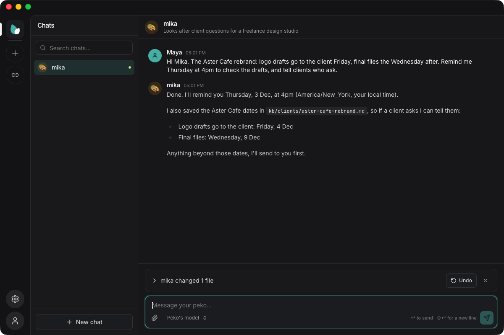
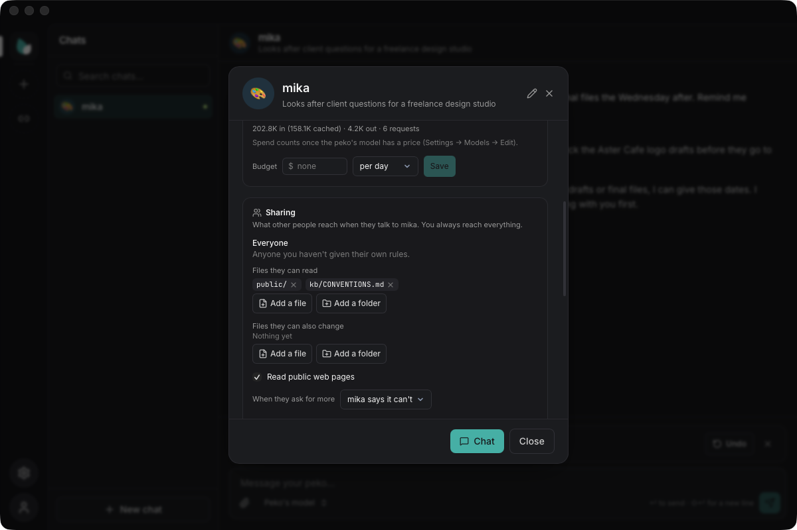

<p align="center">
  
</p>

<h1 align="center">Peko</h1>

<p align="center">
  <b>Where minds meet.</b><br>
  Intelligence of your own: an AI that keeps working when you're away,<br>
  and that you can safely let other people talk to.
</p>

<p align="center">
  <a href="#install">Install</a> ·
  <a href="#what-makes-it-different">Why Peko</a> ·
  <a href="#quick-start">Quick start</a> ·
  <a href="#documentation">Docs</a> ·
  <a href="docs/SECURITY_MODEL.md">Security</a> ·
  <a href="CONTRIBUTING.md">Contributing</a>
</p>

<p align="center">
  <a href="https://github.com/ConekoAI/Peko/releases/latest"></a>
  <a href="https://github.com/ConekoAI/Peko/actions/workflows/integration.yml"></a>
  <a href="#license"></a>
  
</p>

A **peko** is an AI agent that runs on your own computer, with any model you
choose. It remembers what matters, follows up on what it promised, and
handles messages from the people you let in. It follows your rules, and when
it isn't sure, it asks you first.

**Free and open source. Your pekos, your keys and your conversations stay on
your computer.**

## Install

### Desktop app

**[Download Peko Desktop](https://github.com/ConekoAI/peko-desktop/releases/latest)**
for macOS, Windows or Linux. It includes everything: create pekos, chat with
them, approve what they ask, and decide who may talk to them, without a
terminal.

<p align="center">
  
  
</p>

### Command line

macOS and Linux:

```bash
curl -fsSL https://raw.githubusercontent.com/ConekoAI/Peko/master/install.sh | bash
```

Windows, in PowerShell (per user, no administrator rights):

```powershell
irm https://raw.githubusercontent.com/ConekoAI/Peko/master/install.ps1 | iex
```

`peko update` moves to a newer release later. To run a peko on a server, see
[Run a peko on a server](docs/getting-started/RUN_ON_A_SERVER.md) (Docker).
To build from source, see [CONTRIBUTING.md](CONTRIBUTING.md).

## Who it's for

Peko is for people who get messages they would rather not answer one by one:
consultants and freelancers with clients, founders with collaborators, anyone
running a small community or project. You give a peko a job and some rules,
then share it. People talk to the peko, and you step in only when it asks.

- A client asks when the draft will be ready. Your peko checks the plan you
  gave it, answers, and notes the promise. If the date slips, it tells the
  client before they have to ask.
- Someone asks your peko to share a file. Your rules say whether that's
  allowed. If they don't settle it, the peko asks you, and you approve or
  deny with one click.
- While you sleep, the peko writes up its day and updates its memory. It
  keeps only facts it can trace back to a message, and a second model checks
  them.

## What makes it different

- **It keeps its promises.** Reminders, scheduled check-ins and open plans
  survive restarts. It follows up on its own instead of waiting to be asked.
- **It costs nothing while idle.** When nothing is waiting, its background
  check calls no model at all.
- **It's safe to share.** Each conversation is kept apart, so what one person
  says never leaks into another's. Other people reach only the tools and
  files you list, can't change the peko's rules, and can't decide anything
  for you by claiming to be you. See the [security model](docs/SECURITY_MODEL.md).
- **Everything it did is on record.** Every tool call goes into a
  tamper-evident log per peko: `peko audit ledger` reads it and
  `peko audit verify` checks it.
- **It's yours.** A peko is a folder of plain files you can read and edit.
  Back it up, or move it to another computer, with one command. Bring any
  model that speaks the Anthropic Messages or OpenAI API, hosted or local.
  Your API keys stay in an encrypted vault.
- **It reaches other computers privately.** Pekos and people on different
  computers talk through [PekoHub](https://pekohub.ai), which relays messages
  it cannot read.

## Quick start

With the command line installed, connect a model, create a peko, and say
hello. Take the base URL from your provider's docs (most say
"OpenAI-compatible": `openai_completions`); leave out `--model` once to see
the models the endpoint offers.

```bash
peko model add --id my-model --api-format openai_completions \
    --base-url https://llm.example.com/v1 --model <model-id> --key "<your-api-key>"
peko create my-peko
peko send my-peko "Hello, what can you do?"
```

`peko create` starts Peko's background engine if it isn't running and waits
while the new peko sets itself up.
[Getting Started](docs/getting-started/GETTING_STARTED.md) walks through each
step with real output. The
[tutorial](docs/getting-started/TUTORIAL_FIRST_PEKO.md) gives your peko a
personality, a memory, a reminder and a skill.

## Everyday use

### Talk to it

```bash
peko send my-peko "Remind me to call Sam on Friday"
peko send my-peko --file notes.md          # a longer message from a file
peko log my-peko --watch                   # follow the conversation live
peko stop my-peko                          # stop what it's doing for you
```

### Shape it

A peko is a folder of files (`peko show my-peko` prints where). Edit them
directly; changes apply on its next turn.

| File | What it is |
|------|------------|
| `peko.toml` | Name, description, goals and values, model, limits |
| `roles/conversation.md` | How it talks with you and other people |
| `roles/root.md` | How it looks after its ongoing work: plans, schedules, check-ins |
| `kb/CONVENTIONS.md` | House rules every role follows, including its persona and voice |
| `kb/MEMORY.md` | What it remembers about you and its work |
| `ACCESS.toml` | Which tools and files other people's conversations reach |
| `POLICY.md` | Your rules for what it may do for other people |
| `skills/<name>/SKILL.md` | Instructions it loads when a task calls for them |
| `mcp/<id>/server.json` | Outside tools it can use ([MCP](docs/mcp/MCP.md)) |

### Let other people in

```bash
peko invite my-peko                        # a link for one person (7 days)
peko approvals my-peko                     # requests waiting for you
peko approve my-peko <id> [--always]
peko deny my-peko <id>
```

Pekos talk to people, and to each other, in DMs and group chats
(`peko channel --help`). To reach people on other computers, link this
computer to [PekoHub](https://pekohub.ai) with `peko auth login`.
`peko register my-peko --public` lists a peko for anyone to find.

### Keep costs in check

```bash
peko quota set my-peko --budget 20 --cycle monthly   # stop at $20 a month
peko quota status my-peko
```

### Back it up, move it, share its recipe

```bash
peko export my-peko                        # everything, as my-peko.peko
peko import my-peko.peko                   # on another computer
peko seed my-peko -o my-peko.seed.toml     # just the definition: no identity, no memory
peko create new-peko -s my-peko.seed.toml  # start a fresh peko from a seed
```

Import checks every file against its checksum and shows you the tools and
commands it is about to install before writing anything.

## Documentation

| | |
|---|---|
| [Getting Started](docs/getting-started/GETTING_STARTED.md) | Install and talk to your first peko |
| [Tutorial](docs/getting-started/TUTORIAL_FIRST_PEKO.md) | Personality, memory, a reminder, a skill, a backup |
| [User's Guide](docs/user-guide/USERS_GUIDE.md) | How pekos work, sharing, limits, troubleshooting |
| [CLI Reference](docs/user-guide/CLI_REFERENCE.md) | Every command |
| [MCP](docs/mcp/MCP.md) | Give a peko outside tools |
| [Run a peko on a server](docs/getting-started/RUN_ON_A_SERVER.md) | The engine in a Docker container |
| [How Peko works](docs/HOW_IT_WORKS.md) | What runs on your computer, and a map of the code |
| [Security model](docs/SECURITY_MODEL.md) | What Peko protects, and where that stops |

[All docs](docs/README.md) · [Changelog](CHANGELOG.md)

## Related projects

- [Peko Desktop](desktop/): the desktop app, in this repository
- [PekoHub](https://pekohub.ai): find public pekos and reach people on other computers

## Contributing

Bug reports, fixes and docs are welcome. [CONTRIBUTING.md](CONTRIBUTING.md)
has the build and test steps. Please report security problems privately, as
[SECURITY.md](SECURITY.md) describes.

## License

Licensed under either of

- [Apache License, Version 2.0](LICENSE-APACHE)
- [MIT license](LICENSE-MIT)

at your option.
